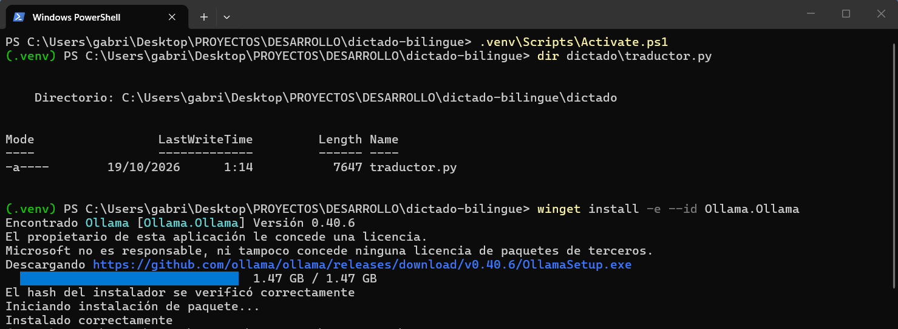
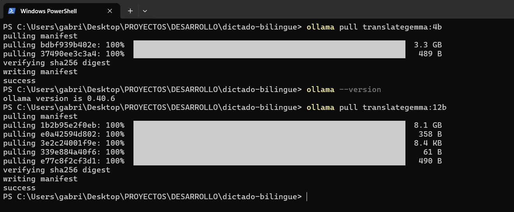
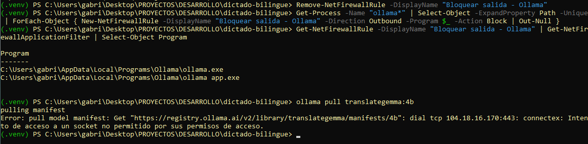
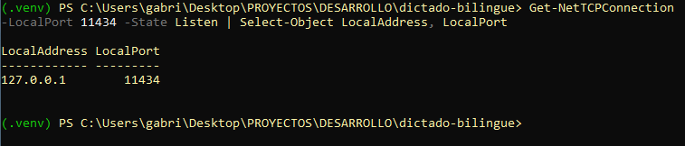
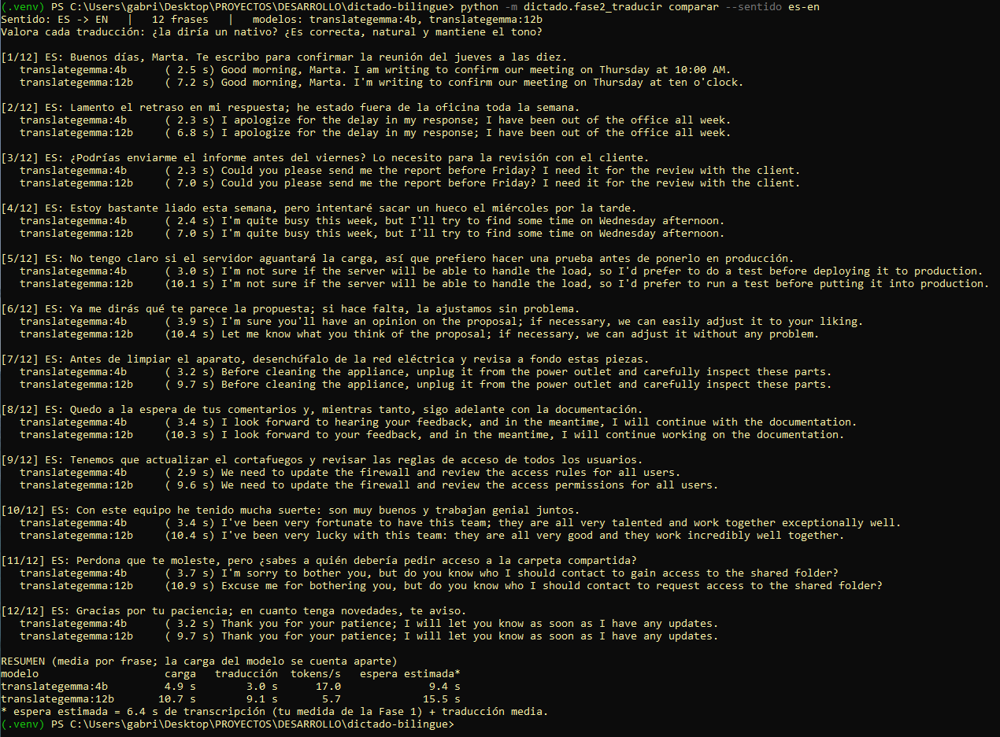
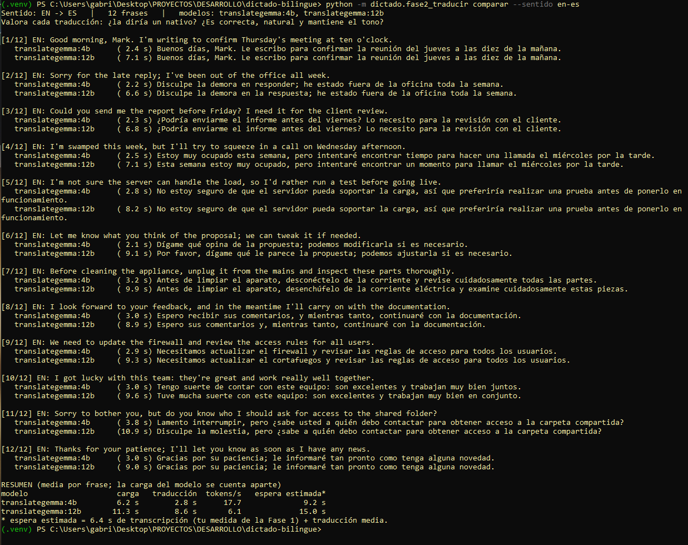
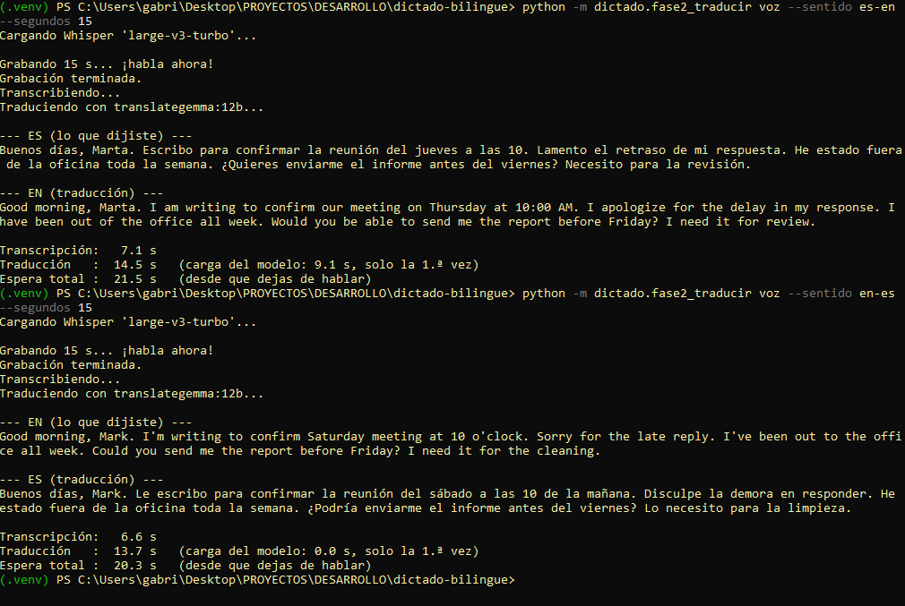

# Fase 2 · Traducción local (ES ⇄ EN)

Objetivo: elegir, con **tus** frases, el modelo que traduzca de la forma más natural, correcta y "nativa", y comprobar el flujo completo *voz → texto traducido*.

## Decisión de motor (y por qué)

Para esta fase el motor de traducción es **Ollama** (un servidor local que ejecuta modelos). Es una decisión **para evaluar**, no necesariamente la definitiva.

| Opción | A favor | En contra |
| --- | --- | --- |
| **Ollama** (elegida ahora) | Los modelos de traducción de Google (TranslateGemma) están en su biblioteca; cambiar de modelo es un comando; sin dependencias nuevas en Python | Es un proceso externo con su propio actualizador y fuera del bloqueo de red de Python → se mitiga con firewall (ver abajo) |
| `llama-server` (llama.cpp) | Un solo ejecutable, escucha por defecto solo en 127.0.0.1, admite `--api-key` y `--offline` | Hay que conseguir y verificar el modelo en formato GGUF por tu cuenta |
| llama-cpp-python (en proceso) | Todo dentro de Python, con nuestro bloqueo de red | En Windows hay que compilar (Visual Studio) o usar ruedas precompiladas de un índice de terceros |
| CTranslate2 (ya instalado) | Cero software nuevo | Convertir modelos exige instalar PyTorch + Transformers; los modelos pequeños (NLLB, OPUS-MT) suenan menos "nativos" |

En la **Fase 6** (endurecimiento) decidiremos si el producto final conserva Ollama o pasa a `llama-server`/en proceso, ya conociendo qué modelo gana.

## Modelos a comparar

| Modelo | Tamaño en disco/RAM* | Nota |
| --- | --- | --- |
| `translategemma:4b` | 3,3 GB | Pensado para móviles y equipos modestos: el más rápido |
| `translategemma:12b` | 8,1 GB | Pensado por Google para portátiles de consumo; según Google supera a Gemma 3 de 27B |
| `translategemma:27b` | 17 GB | Pensado para una GPU potente. **No** lo recomiendo en CPU |

\* Tamaños de la biblioteca de Ollama. La RAM real durante el uso es algo mayor.

Licencia: la ficha del modelo en Hugging Face indica licencia **Gemma** (términos de uso y política de usos prohibidos de Google). Para uso personal no suele ser problema, pero se documentará en el paquete de autorización final.

La plantilla de prompt de TranslateGemma está en `dictado/traductor.py` (`PLANTILLA_TRANSLATEGEMMA`). Está **reconstruida** a partir de la estructura que publica Ollama; compárala con la ficha oficial: https://ollama.com/library/translategemma

## Paso 1: instalar Ollama (necesita internet)

Descarga desde https://ollama.com/download, o con `winget install -e --id Ollama.Ollama` (comprueba el identificador con `winget search ollama`).

## Paso 2: descargar los modelos (necesita internet, una sola vez)

```powershell
ollama pull translategemma:4b
ollama pull translategemma:12b
```

## Paso 3: cerrar la salida de Ollama (confidencialidad)

Ollama es un programa externo: este proyecto no controla lo que hace por su cuenta. Su documentación indica que en Windows guarda actualizaciones descargadas en `%LOCALAPPDATA%\Ollama`, así que **no asumimos que esté callado**. Con los modelos ya descargados, bloquea su tráfico saliente (PowerShell **como administrador**):

```powershell
# 0) Si ya creaste una regla con este nombre (por ejemplo con una ruta de ejemplo), bórrala:
Remove-NetFirewallRule -DisplayName "Bloquear salida - Ollama"

# 1) Ver las rutas reales de Ollama (debe estar en ejecución). Solo lectura.
Get-Process -Name "ollama*" | Select-Object Name, Path

# 2) Crear una regla de bloqueo por cada ejecutable. COPIA EL BLOQUE TAL CUAL:
#    la ruta se rellena sola con la variable $_ ; no hay que escribir ninguna ruta.
Get-Process -Name "ollama*" | Select-Object -ExpandProperty Path -Unique | ForEach-Object {
    New-NetFirewallRule -DisplayName "Bloquear salida - Ollama" -Direction Outbound `
      -Program $_ -Action Block | Out-Null
}

# 3) Comprobar que cada regla apunta a un .exe REAL (deben salir 2 rutas que existan)
Get-NetFirewallRule -DisplayName "Bloquear salida - Ollama" |
  Get-NetFirewallApplicationFilter | Select-Object Program
```

El tráfico local (127.0.0.1) no lo filtra el cortafuegos, así que el proyecto sigue hablando con Ollama (se comprueba abajo).

- **Para descargar otro modelo**: `Disable-NetFirewallRule -DisplayName "Bloquear salida - Ollama"`, haz el `ollama pull` y vuelve a activarla con `Enable-NetFirewallRule`.
- **Prueba de que el bloqueo funciona (importante):** con la regla activa, ejecuta `ollama pull translategemma:4b` **con el nombre del modelo**. Debe fallar con un error de **conexión de red**. Ojo: `ollama pull` a secas falla siempre por sintaxis (`accepts 1 arg(s)`) y **no prueba nada**. Si el comando termina en `success`, la regla no está bloqueando.
- **Prueba de que lo local sigue funcionando:** con la regla activa, `python -m dictado.fase2_traducir comparar --sentido es-en --modelos translategemma:4b` debe seguir traduciendo.

Comprobaciones adicionales recomendadas:

```powershell
# Ollama debe escuchar solo en 127.0.0.1 (LocalAddress)
Get-NetTCPConnection -LocalPort 11434 -State Listen | Select-Object LocalAddress, LocalPort
```

Revisa también los registros de `%LOCALAPPDATA%\Ollama` y comprueba que **no aparece el texto que has dictado**.

## Paso 4: comparar modelos con frases

```powershell
python -m dictado.fase2_traducir comparar --sentido es-en
python -m dictado.fase2_traducir comparar --sentido en-es
```

Usa las frases de `pruebas/ejemplo_es.txt` / `ejemplo_en.txt`. Para las tuyas, crea `pruebas/mis_frases_es.local.txt` y pásalo con `--frases` (los `*.local.txt` no se versionan). Para cada frase valora, de 1 a 10: ¿suena nativa? ¿es correcta? ¿mantiene el tono (formal/informal)? Puedes añadir modelos con `--modelos a,b,c`; por ejemplo `llama3.1:8b` como referencia generalista (instálalo antes con `ollama pull`).

## Paso 5: probar el flujo completo (voz → texto traducido)

```powershell
python -m dictado.fase2_traducir voz --sentido es-en --segundos 15
python -m dictado.fase2_traducir voz --sentido en-es --segundos 15
```

## Qué debes apuntarme

1. Modelo ganador por calidad en cada sentido y su nota.
2. Tiempo de traducción medio y "espera total" de la tabla final.
3. Si la espera total te resulta aceptable para escribir un correo.
4. Cualquier error o comportamiento raro (por ejemplo, que añada comentarios al traducir).

## Resultados y evidencias (portátil del proyecto)

Estado: **completada y verificada**, incluido el cierre de red de Ollama.

| Modelo | Traducción media/frase | Espera total estimada* | Nota subjetiva |
| --- | --- | --- | --- |
| `translategemma:4b` (**elegido**) | ~3,0 s | ~9,3 s | 9,5/10 |
| `translategemma:12b` | ~8,9 s | ~15,3 s | 9,5/10 |

\* 6,4 s de transcripción (medida en la [Fase 1](../01-transcripcion/README.md)) + traducción.
Análisis detallado y observaciones de calidad en [docs/PLAN.md](../../docs/PLAN.md).

| # | Captura | Qué demuestra |
| :---: | --- | --- |
| 1 |  | Instalación de Ollama con `winget` (hash del instalador verificado) |
| 2 |  | Descarga de `translategemma:4b` y `:12b` (único paso con internet) |
| 3 |  | Regla de salida bloqueada para los dos ejecutables de Ollama y prueba de bloqueo: `ollama pull` falla con *intento de acceso a un socket no permitido* |
| 4 |  | Ollama escucha solo en `127.0.0.1:11434` |
| 5 |  | Comparativa 4b vs 12b, español → inglés |
| 6 |  | Comparativa 4b vs 12b, inglés → español |
| 7 |  | Flujo completo voz → traducción en ambos sentidos (con 12b) |
