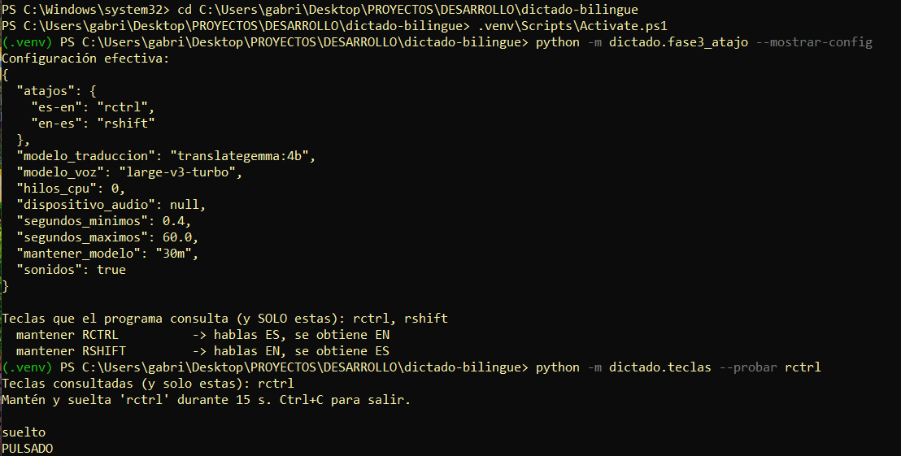
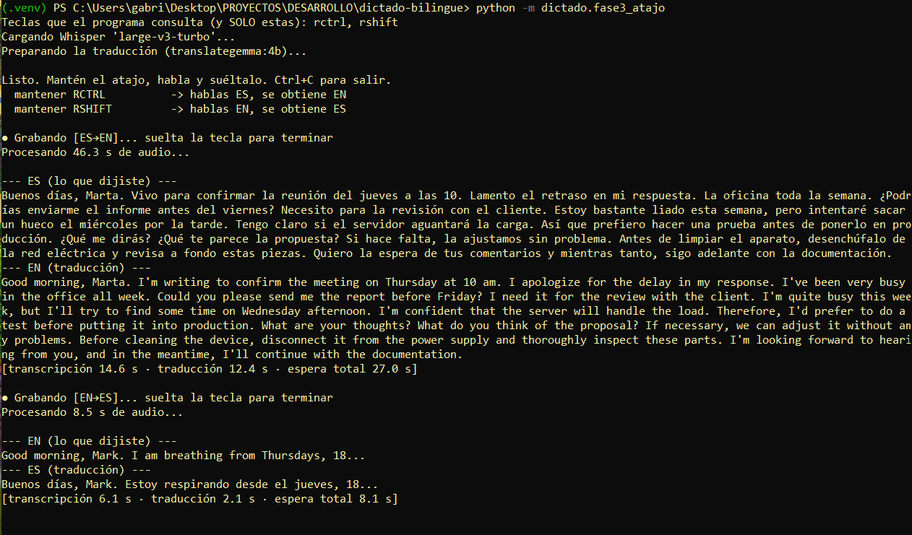
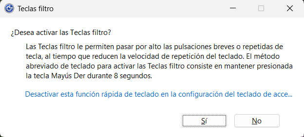

# Fase 3 · Atajo "mantener para hablar"

> Estado: ✅ **hecha y probada en mi portátil.** Funcionan los atajos y los pitidos; lo que sigue flojo es la transcripción de mi inglés (ver «Resultados»). El proyecto queda en pausa después de esta fase: [cómo retomarlo](../../docs/RETOMAR.md).

Objetivo: mantener una tecla, hablar, soltarla y ver el texto traducido, sin ejecutar un comando por cada frase. Todavía **no escribe en otras aplicaciones** (Fase 4): muestra original y traducción en la ventana de PowerShell.

## Cómo funciona

Es un *walkie-talkie*: mientras mantienes el botón, el micrófono está abierto; al soltarlo, se cierra y empieza el trabajo.

```text
mantener atajo ─► pitido agudo ─► micrófono abierto (audio solo en RAM)
soltar atajo   ─► micrófono cerrado ─► pitido grave ─► Whisper ─► Ollama ─► pantalla
```

Dos atajos, uno por sentido (sin modos ni conmutadores que recordar):

| Atajo por defecto | Hablas | Se obtiene |
| --- | --- | --- |
| mantener **Ctrl derecho** | español | inglés |
| mantener **Mayús derecho** | inglés | español |

## Decisión de diseño: leer solo las teclas del atajo

Un programa que "escucha atajos" suele instalar un gancho que ve **todas** las teclas (como un keylogger). Aquí no.

| Opción | Qué ve del teclado | Dependencias |
| --- | --- | --- |
| Biblioteca de atajos globales (p. ej. `pynput`, `keyboard`) | Todo lo que escribes | Una más que auditar |
| Gancho de bajo nivel de Windows | Todo lo que escribes | Ninguna |
| **`GetAsyncKeyState` (elegida)** | **Solo las 1-3 teclas del atajo** | Ninguna (`ctypes` ya viene con Python) |

Cada 20 ms se pregunta a Windows únicamente "¿está pulsada esta tecla?" para las teclas del atajo. Todo el código está en `dictado/teclas.py`.

Lo puedes auditar:

```powershell
python -m dictado.fase3_atajo --mostrar-config   # lista las teclas que se consultan y sale
```

## Por qué elegí estos atajos por defecto

- **No se "come" la pulsación:** este método lee el estado de las teclas, pero la aplicación activa también las recibe. Por eso se evitan combinaciones con efecto propio: `Ctrl+Espacio` en Word borra el formato; `F9` en Outlook envía y recibe; etc. Ctrl derecho y Mayús derecho casi nunca hacen nada por sí solos.
- **Trampa del teclado español:** `Ctrl+Alt` equivale a **AltGr** (el `@` es `AltGr+2`). Una combinación con `Ctrl+Alt` se activaría al escribir `@`, `#` o `€`. El programa rechaza esas combinaciones y también `ralt`.
- **Pulsaciones accidentales:** las de menos de 0,4 s se ignoran (se puede cambiar).
- **Si tu teclado no tiene esas teclas, o te molestan:** cámbialas en `config.local.json`.

Para probar una combinación en vivo (consulta solo esas teclas):

```powershell
python -m dictado.teclas --probar rctrl
python -m dictado.teclas --probar f8
```

## Configuración (opcional): `config.local.json`

Copia `config.ejemplo.json` como `config.local.json` y deja solo lo que quieras cambiar.
Ese archivo no se versiona. Las claves desconocidas o los valores inválidos se rechazan con un mensaje claro.

| Clave | Por defecto | Qué hace |
| --- | --- | --- |
| `atajos` | `{"es-en": "rctrl", "en-es": "rshift"}` | Teclas de cada sentido. Puedes dejar solo uno |
| `modelo_traduccion` | `translategemma:4b` | Cambia a `translategemma:12b` para máxima calidad (más lento) |
| `modelo_voz` | `large-v3-turbo` | Carpeta del modelo en `models/whisper/` |
| `hilos_cpu` | `0` | 0 = automático |
| `dispositivo_audio` | `null` | Micrófono por defecto de Windows; o el número de `fase1_transcribir --listar-dispositivos` |
| `segundos_minimos` | `0.4` | Pulsaciones más cortas se ignoran |
| `segundos_maximos` | `60` | Tope de grabación; al llegar se procesa lo grabado |
| `mantener_modelo` | `30m` | Tiempo que Ollama conserva el modelo en RAM tras usarlo (unos 4 GB con el 4b) |
| `sonidos` | `true` | Pitido al empezar (agudo) y al terminar (grave) |

Atajos: nombres como `rctrl`, `rshift`, `lshift`, `lctrl`, `space`, `f1`-`f24`, letras, dígitos, `num0`-`num9`, flechas, `home`, `end`... y combinaciones con `+` (`rshift+f8`). Los atajos no pueden solaparse (que uno contenga al otro).

## Cómo probarlo

Antes, comprueba que el cortafuegos de Ollama sigue activo (ver la [Fase 2](../02-traduccion/README.md)).

```powershell
python -m dictado.fase3_atajo --mostrar-config
python -m dictado.fase3_atajo
```



Al arrancar carga Whisper y "calienta" el modelo de traducción para que la primera frase real no espere. Luego:

1. Mantén **Ctrl derecho**, di una frase en español, suelta. Debe salir en inglés.
2. Mantén **Mayús derecho**, di una frase en inglés, suelta. Debe salir en español.
3. Haz una pulsación muy corta: debe decir que la ignora.
4. Dicta un párrafo de unos 25 s y mide la espera total.
5. Pulsa **Ctrl+C** para salir.

## Qué debemos apuntar

1. ¿Funcionan los atajos? ¿Te molesta algún efecto en otras aplicaciones al pulsarlos?
2. ¿Oyes los pitidos y se distinguen? ¿Se cuelan en la grabación?
3. Espera total con `translategemma:4b` (primera vez que se mide `voz` con este modelo).
4. Cualquier error, tecla que no responda o comportamiento raro.

## Qué se probó y qué no

Probado con teclado, grabadora, Whisper y Ollama **simulados** (60 comprobaciones): lectura de teclas, solapes, máquina de estados, configuración, flujo en ambos sentidos, pulsación corta, límite de duración, Ollama caído, pulsar durante el procesado, `Ctrl+C` a mitad de grabación, y que solo se consultan las teclas del atajo.

**No probado (hace falta hacerlo en mi equipo):** `GetAsyncKeyState` real en Windows, el micrófono real, los pitidos, y el comportamiento con mis aplicaciones y el teclado.

## Limitaciones conocidas de esta fase

- **Solo mostrará el resultado en la ventana.** Escribirlo en la aplicación activa es la Fase 4.
- **Mientras procesa (varios segundos) no escucha el atajo**; lo pulsado en ese tiempo se ignora.
- **El historial de la ventana de PowerShell conserva lo que se muestra.** Cierra la ventana o ejecuta `cls` al terminar si el contenido es confidencial.
- **Antivirus:** tener en cuenta que un programa que consulta teclas puede levantar sospechas, aunque aquí solo consulta las del atajo. Si salta una alerta, anótarla.
- **El modelo queda en RAM** `mantener_modelo` tras la última traducción; al salir con `Ctrl+C` se libera.

## Resultados de la prueba en Windows real

Atajos, pitidos y consola funcionaron. Mediciones con `translategemma:4b`:



| Prueba | Audio | Transcripción | Traducción | Espera total |
| --- | --- | --- | --- | --- |
| ES→EN, 12 frases seguidas | 46,3 s | 14,6 s | 12,4 s | 27,0 s |
| EN→ES, una frase | 8,5 s | 6,1 s | 2,1 s | 8,1 s |

- La transcripción de 46 s tarda ~2× la de 8 s porque Whisper procesa ventanas de 30 s (dos ventanas).
- **Problema de calidad (no de los atajos):** en el dictado largo en español, Whisper perdió palabras («He estado fuera de…»), cambió otras («Quedo a la espera» → «Quiero la espera») y **borró un «No»**: «No tengo claro si el servidor aguantará la carga» salió como «Tengo claro…», y la traducción afirmó «I'm confident that the server will handle the load».

El traductor tradujo bien lo que recibió; el error vino de la transcripción y **cambió el sentido**. Esto confirma que hace falta la pantalla «revisar antes de escribir» (Fase 4) y mejorar la transcripción (banco de pruebas, abajo).

## Aviso de Windows: «Teclas filtro»

Mantener **Mayús derecho 8 segundos** activa en Windows el aviso de *Teclas filtro*. Un dictado largo en EN→ES lo dispara y la ventana roba el foco. Soluciones, de menor a mayor cambio:

1. En el propio aviso, pulsa el enlace *Desactivar esta función rápida de teclado…* (solo quita el acceso rápido; no desactiva la accesibilidad). Alternativa: Configuración → Accesibilidad → Teclado → Teclas filtro → desactivar «Método abreviado de teclado».

    

2. Cambiar `en-es` en `config.local.json` a una tecla que no sea Mayús derecho (el aviso solo salta con esa tecla), por ejemplo `f8`. Evita `lshift`: la usas al escribir mayúsculas y empezaría a grabar sin querer.

## Banco de pruebas de transcripción (pendiente)

Para decidir con datos cómo mejorar la transcripción, `dictado/banco_transcripcion.py` graba **una vez** (en RAM) un texto conocido y prueba varios ajustes de Whisper sobre ese mismo audio, midiendo el error por palabras (WER) y mostrando qué palabras falla cada uno:

```powershell
python -m dictado.banco_transcripcion --idioma es --frases 6
python -m dictado.banco_transcripcion --idioma en --frases 6
```

Ajustes comparados: `actual`, `sin_vad` (sin filtro de silencios), `vad_suave` (el filtro recorta menos), `con_pista` (vocabulario de contexto) y `con_contexto` (usa el texto previo).

Para probar además el modelo completo `large-v3` (más preciso, más lento, ~3 GB; paso con internet):
`python -m dictado.descargar_modelos --modelo large-v3` y luego `--modelos large-v3-turbo,large-v3`.
